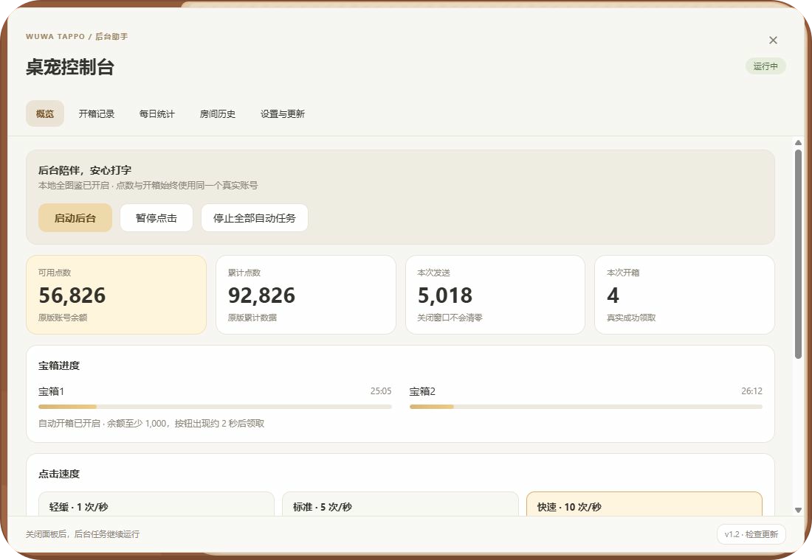
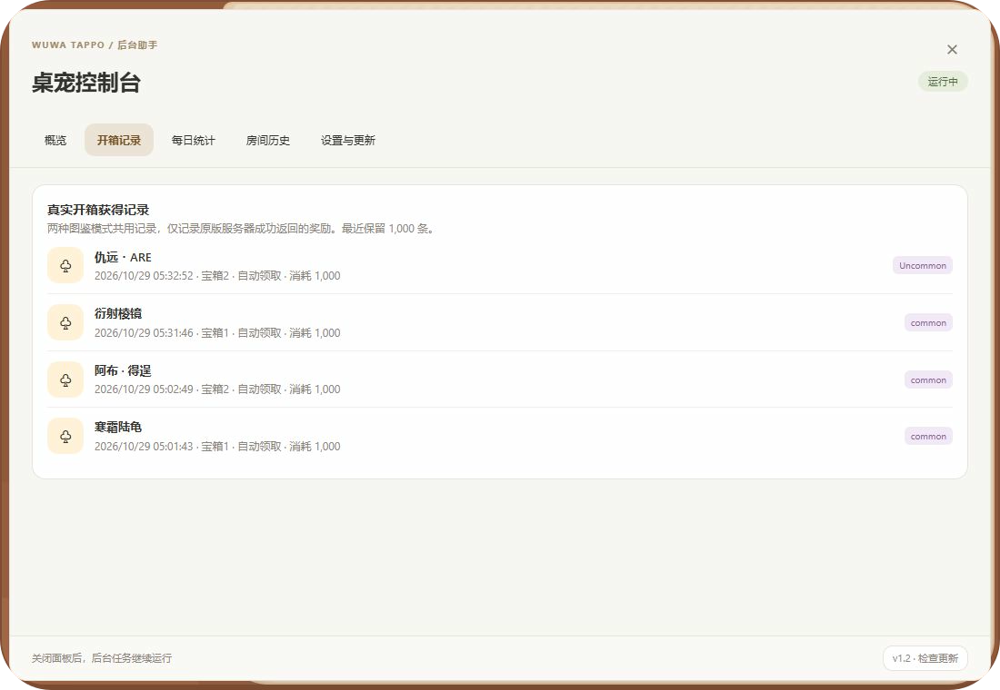
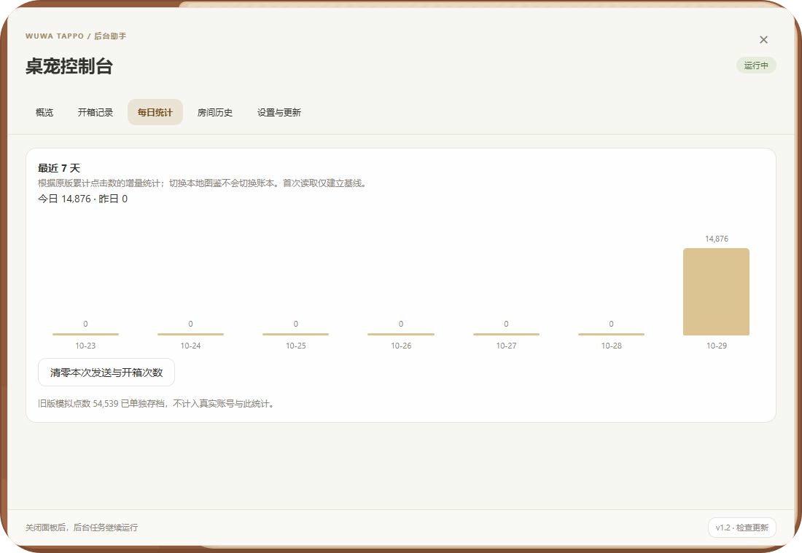

  

<h1 align="center">WuwaTappo全图鉴版</h1>

  <strong>自己玩时自由使用全图鉴，后台积累真实账号物品，需要联机时随时切回。</strong>

  本地全图鉴 · 后台自动点击 · 自动开宝箱 · 真实奖励记录 · 每日统计

  
  
  
  

  📱 <strong>现已推出安卓版：</strong>
  <a href="https://github.com/Averionx/WuwaTappo-Android">WuwaTappo Android版 · 查看介绍与下载</a> 
  将桌宠带到安卓输入法，让喜欢的角色陪你打字。

  <a href="#这是什么项目">项目介绍</a> ·
  <a href="#界面预览">界面预览</a> ·
  <a href="#下载与升级">下载与升级</a> ·
  <a href="#使用">使用方法</a> ·
  <a href="#常见问题">常见问题</a>

---

## 这是什么项目？

**WuwaTappo全图鉴版**在原版 Windows 桌宠的基础上，增加可开关的本地全图鉴、后台自动点击和自动开宝箱。保留原版角色形象、配件、表情和动作，可以在背包或图鉴中搭配喜欢的外观，也可以随时关闭本地图鉴，恢复真实账号的物品与装扮。

后台助手直接沿用桌宠原有的敲击动作和计数流程。你正常打字、切换输入法或按住鼠标拖动时，自动点击会暂时避让，空闲后继续运行；自动开箱独立检查，到期后不需要等你停用键鼠。不向其他软件输入字符，不移动鼠标或切换前台窗口。自动点击和自动开箱分别控制，两个开关可以独立使用。

### 自己玩用全图鉴，联机时用账号收藏

平时一个人使用桌宠时，可以开启本地全图鉴，直接挑选喜欢的角色、配件和表情，不必等账号逐个开出来。同时，你可以开启后台自动点击和自动开箱，按原版流程累积真实点数、领取宝箱，为账号慢慢积累实际拥有的物品。

等到想和朋友联机时，关闭本地全图鉴即可恢复账号背包。**之前真实开箱获得的物品会保留，可以带到正常模式和联机中使用**，不用因为平时使用本地图鉴，就放弃积累自己的账号收藏。

| 使用场景 | 图鉴与物品 | 点击和开箱 |
| --- | --- | --- |
| 一个人陪伴、搭配外观 | 开启本地全图鉴，使用本机完整角色、配件与表情 | 可以同时累计真实点数、自动领取真实宝箱 |
| 想和朋友联机 | 关闭本地全图鉴，使用账号实际拥有的物品 | 已有点数与真实奖励保留，自动化开关也保留 |

宝箱仍按原版冷却、费用和掉落结果运行。账号收藏需要逐步获得，**本地全图鉴开关不会直接把全部物品写入线上账号**。

**修改版 1.2 适配官方 1.0.2。本地全图鉴只改变本机物品展示与装扮，开启时禁止进入联机房间。两种模式共用原版真实账号的累计点数、可用点数、冷却和开箱奖励。** 图片、公告、登录及更新正常联网。

这是非官方修改项目，与 WuwaTappo 官方无隶属关系。本地全图鉴不等于账号获得道具。

## 1.2 更新了什么？

- **真实点数与开箱共用**：无论是否开启本地全图鉴，都使用原版账号的累计点数、可用点数、宝箱冷却和服务器奖励；切回正常模式后，真实开出的物品仍在账号背包中。
- **新的桌宠控制台**：集中展示余额、累计点数、本次发送与开箱数、宝箱1和宝箱2的进度，支持每秒 1、5、10 次速度切换。
- **开箱获得记录**：查看获得的物品、稀有度、领取时间、来自哪个宝箱和点数消耗；手动与自动开箱都会记录。
- **关闭面板继续运行**：关闭控制台不会停止后台，切换本地图鉴不会重置自动化设置。
- **每日统计与房间历史**：查看今日、昨日和最近 7 天点击增量，记住进入过的房间并收藏置顶，重启时恢复显示器位置。
- **仓库更新监控**：启动及每 30 分钟检查本项目正式版本，完整新版发布后必须更新，支持下载、校验、备份、原地替换和重启。

## 界面预览

### 本地全图鉴

角色、配件与表情可以在本机直接选择。下面展示全图鉴页面的一部分，完整列表可继续滚动查看。

### 桌宠控制台

账号点数、会话计数与宝箱1、宝箱2的进度集中显示。自动点击与自动开箱独立控制，关闭面板后后台继续运行。

### 开箱获得记录

显示原版服务器已确认的奖励，方便查看自动领取获得了什么。这里的记录不会把本地图鉴展示的物品当作账号奖励。

### 每日点击统计

两种图鉴模式共用真实累计点击数的增量，今日、昨日和最近 7 天的数据放在一起查看。

## 下载与升级

前往 [GitHub Releases 发行与下载页面](https://github.com/Averionx/WuwaTappo-FullAtlas/releases)，在对应版本的 **Assets** 中选择安装包。本文对应 **1.2（官方基底 1.0.2）**，旧版附件不包含 1.2 的新功能。功能与实测说明见 [开发记录](docs/DESKTOP_PROGRESS.md)。

- 系统：Windows 10 / 11，x64。
- 已安装全图鉴版：退出桌宠，运行 **WuwaTappo-FullAtlas-1.2-Upgrade.exe**。直接升级原目录，无需重新安装官方程序。
- 新安装：使用 **WuwaTappo-FullAtlas-1.2-Setup.exe**。包含本地素材、服务和专用 WebView2 运行时，不需要另装 Python 或 Node.js。GitHub 附件使用英文文件名，安装界面和快捷方式名称仍为 **WuwaTappo全图鉴版**。
- 升级保留账号目录、本地选择、统计、收藏和已同步的素材。安装与启动可能需要 Windows 管理员确认；旧版整段断网规则会自动移除。
- 下载后核对随包的 SHA256 清单。程序和安装包没有商业代码签名。

## 使用

1. 从桌面 **WuwaTappo全图鉴版** 快捷方式启动。
2. 右键桌宠 → **设置** → 开启 **本地全图鉴**。
3. 在背包或图鉴中选择角色、配件和表情。原有角色专属适配和表情数量上限继续生效。
4. 打开 **设置 → 挂机与统计 → 打开**，配置自动点击、自动开箱和统计。
5. 需要恢复账号物品与外观时，关闭本地全图鉴。切换不重启后台、不重置计数和开关。

## 挂机与统计

| 功能 | 行为 |
| --- | --- |
| 后台自动点击 | 只在桌宠内部成对调用原按下、释放处理函数，沿用原动画和计数。不向 Windows 输入队列注入键鼠事件，不移动鼠标、不切换前台窗口，也不触发自定义快捷键。 |
| 输入避让 | 自动点击检查键盘、Shift 和鼠标按住状态，有输入时暂停；空闲 250 毫秒后恢复。自动开箱不等待键鼠空闲。存在系统调度延迟，不承诺硬实时保证。 |
| 会话看板 | 每秒 1、5、10 次可切换；展示原版余额、累计点数、本次发送与开箱数。设置自动保存，关闭控制台和切换图鉴不暂停后台。停止全部自动任务时同时关闭自动点击与自动开箱。 |
| 自动开箱 | 原开箱按钮出现且可点击、余额达到阈值后，等待约 2 秒再点击；使用键盘或鼠标不会重置这段等待。沿用原按钮的动画、冷却与检查；失败后保留重试间隔。 |
| 开箱记录 | 记录原版服务器成功返回的奖励名称、类型、稀有度、消耗、时间、宝箱位置及手动/自动来源，最近保留 1000 条。记录保存失败只重试保存，不重开宝箱。 |
| 每日点击数 | 两种图鉴模式共用真实累计点击数增量，展示今日、昨日和最近 7 天柱状图。首次运行无法补出之前的每日历史。 |
| 屏幕记忆 | 记住显示器，重启沿用原切屏流程恢复。显示器不存在或名称不唯一时，保持当前位置。 |
| 房间历史 | 成功进入房间后记录房间号和房主，点击可再次加入，星号收藏置顶。开启本地全图鉴时禁止加入。房间满员或失效仍由服务器决定。 |
| 托盘与面板 | 保留原版托盘与原面板生命周期。控制台关闭只停止自己的界面刷新，后台引擎留在主桌宠中。主桌宠仍使用 WebView2，不承诺整套程序只有几兆内存或绝对零 CPU。 |

## 本地模式与联网

本地全图鉴只是本机的展示和选择层。公告、登录、素材下载、公开图鉴同步和修改版更新继续联网；不会新增针对整个程序的断网防火墙规则。

联机房间的创建、加入和连接会被阻止。未拥有的本地图鉴物品不会通过合成、账号外观和预设写入真实账号。**真实开箱接口保持可用**，自动开箱在两种模式下都要求原版账号登录，沿用原版按钮、费用、冷却及服务器结果。断网、登录失效或余额不足时不能获得服务器奖励。

1.1 的旧模拟点数和本地开箱不会转换为服务器奖励。升级后作为历史存档保留，新的点击全部使用原版真实计数流程。图鉴全解锁与账号实际拥有的物品不同，关闭本地开关后以账号背包为准。

## 新增图鉴与一键更新

设置中的 **更新本地图鉴 → 检查并同步** 在本地全图鉴开启时也可使用。普通启动也会检查公开素材。目录、ID 映射和全部图片校验完成后才切换缓存，失败保留原缓存；其他窗口会同步刷新新目录。当前快照为 899 项图鉴、3098 个 PNG，数量随官方公开目录变化。

修改版启动后监控 **Averionx/WuwaTappo-FullAtlas** 仓库，随后每 30 分钟检查正式 Release。发现高于当前版本、且已上传完整升级 ZIP 与有效 SHA256 清单的版本后，**必须更新才能继续使用**，自动点击和开箱暂停。弹窗提供一键更新、重试检测及退出；普通代码提交、README 修改、草稿和预发布不触发强制升级。

升级自动下载、校验、备份、替换及重启；匹配版本的新前端确认健康后才清理旧程序备份，启动超时回退。下载失败保留原程序和重试入口；已确认的更新要求在重启和临时网络故障后继续生效。尚未确认新版本时，单纯网络错误不会新建更新锁。GitHub 公共 API 限流时使用公开发行页面，不需要 GitHub 令牌。旧客户端必须先安装支持此功能的版本，无法追溯控制未安装更新检测逻辑的旧包。

素材更新与程序适配不同。官方新增素材且结构兼容时可同步；官方改变 EXE 或接口结构时，需要验证新的适配版。不会盲目运行官方安装器覆盖修改版，也不承诺支持所有未知版本。首次升级仍建议自行保留目录副本，断电和磁盘损坏不属于正常回退可以保证的情况。

## 常见问题

**不开自动点击，只开自动开宝箱可以吗？**

可以。正常打字或点击桌宠仍会累计点数。只开启自动开箱时，账号已登录、冷却结束且余额达到阈值后，助手会等待原版开启按钮出现约 2 秒再领取。

**宝箱到期时，我还在打字或使用鼠标，会影响自动开箱吗？**

不会因为键鼠正在使用而等待。键鼠避让只暂停后台自动点击；自动开箱通过桌宠内部的原版按钮领取，仍检查登录、余额、冷却和按钮状态，不需要你停下手里的操作。

**本地全图鉴开启时，可以自动点击和开箱吗？切回正常模式会保留吗？**

可以。新点击沿用真实计数，开箱使用真实账号的余额和服务器结果，切回正常模式后保留真实获得的物品。开箱需要保持登录和联网。本地图鉴额外显示的未拥有物品只是本机展示，不能作为账号物品使用。

**关掉控制台右上角的关闭按钮，会停止挂机吗？**

不会。关闭按钮只收起控制台。点击“暂停点击”只暂停自动点击，自动开箱开关保持原样；需要全部暂停时，点击“停止全部自动任务”。退出桌宠程序才会结束这次后台运行。

**为什么本地图鉴开启后不能进入联机？**

本地图鉴可以显示账号尚未拥有的外观，开启时会禁止创建、加入和连接联机房间。需要联机时关闭本地全图鉴，恢复账号物品与装扮即可；公告、登录、素材下载、真实开箱和更新仍然正常联网。

## 来源与构建

本仓库新编写的控制器、本地服务、构建和安装脚本采用 [MIT License](LICENSE)。WuwaTappo 原程序、界面和美术素材、WebView2 及其他依赖保留各自权利和许可，详见 [第三方说明](THIRD_PARTY_NOTICES.md)。本仓库的开源许可不构成第三方素材的额外授权。

仓库不包含个人账号、Cookie、控制令牌、官方原版 EXE 或完整提取前端。构建需要另行准备已验证的官方 1.0.2 程序、公开素材缓存和官方 WebView2 运行时，见 [构建说明](docs/BUILD.md)。未知基底会拒绝修改。

反馈问题时请提供系统版本、开关状态和复现步骤，不要上传登录令牌、验证码、Cookie 或整个用户数据目录。
